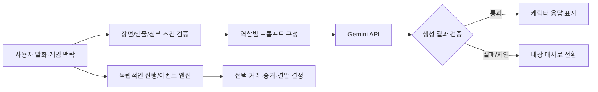

# Case Study 01 · 사기방지위원회
### 금융사기 체험 웹 게임 · 생성형 AI와 게임 상태의 분리

**프로젝트 형태:** 2인 개발 프로젝트 · **주요 관심:** AI 서비스 통합, 대화 생성 제어, 오류 대응  
**저장소:** [hoyhoy1227/whatfraud](https://github.com/hoyhoy1227/whatfraud) · [Live Demo](https://whatfraud.hoyhoy1227.chatgpt.site/)

## 게임 경험과 사용 기술

가상의 스마트폰에서 연락처·은행·브라우저·메모를 오가며 연락과 기록을 비교하고, 답장·보류·차단·가상 송금으로 대응합니다. 지인 사칭 → 투자 자료방 → 회복 지원 사칭 시나리오를 거친 뒤 하루 끝 보고서와 되감기로 다른 선택을 돌아봅니다. 실제 송금·전화·신고를 수행하는 서비스는 아닙니다.

**사용 기술:** React · TypeScript · Next.js 호환 앱 구조 · Vinext/Vite · 서버 Gemini API · Git/GitHub

## Problem

정해진 대사만 반복하는 게임은 상황에 맞는 반응을 주기 어렵습니다. 반대로 LLM에 대화를 완전히 맡기면 이전 선택, 금액, 거래·증거와 충돌하거나 사건의 사실을 임의로 바꿀 수 있습니다.

**목표:** 캐릭터 답변은 생성형 AI로 유연하게 만들되, 게임의 규칙과 진행 상태를 예측 가능하게 유지하는 것.

## How It Works

- 서버의 `/api/ai-chat`에서 입력·문맥을 검증하고 외부 Gemini API를 호출합니다.
- AI는 **제한된 장면의 캐릭터 발화**를 생성합니다. 가상 송금, 사건 순서, 잔액, 결말은 별도의 결정적 이벤트 엔진이 관리합니다.
- 게임 내 AI 사용 기회는 사건별 **2/2/1회, 새 회차 전체 최대 5회**입니다. 실패·취소 시도도 사용량에 남을 수 있습니다. 이는 외부 Gemini HTTP 요청이 총 5회 이하라는 뜻이 아닙니다.
- 서버는 응답 형식·표현 품질이 기준을 통과하지 못하면 **요청당 최대 1회 교정 생성**을 시도합니다. 원래 제한 시간과 호출 제한을 유지하고, 교정에도 공유 예산을 다시 예약합니다. 전송 오류·할당량 실패에 대한 무제한 재시도는 하지 않습니다.
- 지연, 호출 실패, 부적절한 생성 결과는 검사 후 준비된 메시지로 대체할 수 있어 AI 없이도 완주할 수 있습니다.

## Engineering Decisions & Debugging

| 발생한 문제 | 구조적 대응 |
| --- | --- |
| 등장인물이 미공개 사실을 알고 있는 듯 대답 | 인물의 지식 범위와 게임 상태를 구분해 프롬프트·서버 검증에 반영 |
| AI가 첨부를 다시 요구하거나 정상 답장이 검사에서 탈락 | 첨부 허용 목록을 화면/서버에서 일치시키고, 표현 품질 검사와 사실·진행 검사를 분리 |
| 늦게 도착한 비동기 응답이 다른 장면에 표시될 위험 | 응답 게이트·취소와 현 요청 확인 및 장면별 대화 메모리 분리 |
| 저장·되감기에서 거래가 중복 반영될 위험 | 의미 이벤트 재생과 거래 ID 검증, 본편/짧은 체험 저장 상태 분리 |
| API 할당량·지연·품질 실패 | 입력 크기·게임 내 사용량·공유 예산 제한, 요청당 교정 생성 최대 1회, fallback |

콘텐츠·대사, 게임 상태 복원, 송금 중복, 모의 응답/예산 처리를 확인하는 자동 검사 코드가 포함됩니다. 이 포트폴리오 통합 검토에서 검사를 재실행하거나 실제 Gemini 품질을 측정한 것은 아닙니다. **자동 검사는 실사용자의 학습 효과나 모든 실기기 품질을 입증하지 않습니다.**

## What I Learned

LLM 기능을 추가하는 것보다 중요한 것은 **LLM이 바꿀 수 있는 것과 바꿀 수 없는 것을 시스템 경계로 정의하는 일**이었습니다. AI의 유연성과 게임의 일관성을 별도로 설계해야 합니다.

## Contribution & Evidence

- **개인 기여:** 2인 공동 개발에서 기획·구현 전반, 기능·스토리 구성과 Suno 음악 작업에 참여했습니다. 구현은 팀 공동 결과입니다. 기능별 상세 담당은 개인 커밋·이슈 근거로 구체화할 수 있습니다.
- [게임 소개 및 개발 시행착오](https://github.com/hoyhoy1227/whatfraud/blob/main/README.md)
- [AI API 코드](https://github.com/hoyhoy1227/whatfraud/blob/main/app/api/ai-chat/route.ts)
- [프로젝트 구조](https://github.com/hoyhoy1227/whatfraud/blob/main/docs/development/PROJECT_STRUCTURE.md)

- [AI 사용 한도·장면 계약 코드](https://github.com/hoyhoy1227/whatfraud/blob/main/app/story/decision-message.js) · [게임 상태 엔진](https://github.com/hoyhoy1227/whatfraud/blob/main/app/story/engine.js)
- [모의 API·교정·공유 예산 검사](https://github.com/hoyhoy1227/whatfraud/blob/main/tools/tests/test-ai-chat.mjs)
- 실제 화면: [시작](https://github.com/hoyhoy1227/whatfraud/blob/main/docs/images/start-screen.png) · [스마트폰 홈](https://github.com/hoyhoy1227/whatfraud/blob/main/docs/images/phone-home.png) · [메신저](https://github.com/hoyhoy1227/whatfraud/blob/main/docs/images/messenger.png)

**다음 보강:** 실제 Gemini 응답의 동일 장면 전후 비교, 본인 커밋·이슈와 역할 연결, 버전이 명시된 자동 검사 실행 결과, 실사용자 검수 기록.
