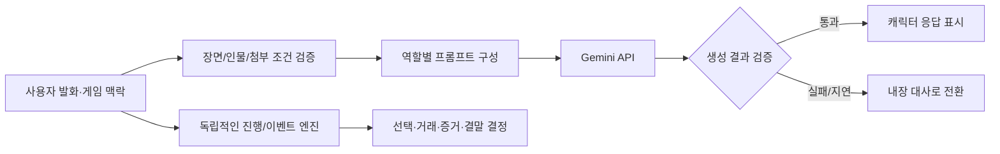

# 02 · 사기방지위원회

**가상의 스마트폰에서 연락과 기록을 비교하고, 답장·보류·차단·가상 송금으로 대응하는 금융사기 체험 웹 게임입니다.**

> **참여 역할** · 기획 · 기능·스토리 구성 · Suno 음악 작업  
> 2인 공동 개발

생성형 AI를 게임 대화에 연결하자, 인물이 아는 사실과 답변이 어긋나거나 첨부 후 답변이 막히는 문제가 생겼습니다.

상황에 맞는 캐릭터 대화를 만들면서, 답변 실패에도 게임이 이어지도록 구성하는 것이 목표였습니다.

## 구현 과정

- Gemini의 답변 생성과 사건·잔액·결말을 관리하는 게임 엔진을 분리했습니다.
- 이미 한 행동과 인물이 아는 사실을 대화 문맥에 반영했습니다.
- 첨부 허용 목록의 화면·서버 차이를 맞추고, 답변 검사와 준비 대사로 실패에 대응했습니다.

## 주요 결과

3막의 플레이와 보고서·되감기를 제공하는 웹 데모를 구현했습니다. 실제 이상 답변·무응답 사례를 원인과 코드 수정에 연결해 기록했습니다.

[게임 실행](https://whatfraud.hoyhoy1227.chatgpt.site/) · [소스 코드](https://github.com/hoyhoy1227/whatfraud) · [실제 제작 오류](development-cases.md)

처리 과정·평가 조건·원본 근거 자세히 보기

## 게임 경험과 사용 기술

가상의 스마트폰에서 연락처·은행·브라우저·메모를 오가며 연락과 기록을 비교하고, 답장·보류·차단·가상 송금으로 대응합니다. 지인 사칭 → 투자 자료방 → 회복 지원 사칭 시나리오를 거친 뒤 하루 끝 보고서와 되감기로 다른 선택을 돌아봅니다. 실제 송금·전화·신고를 수행하는 서비스는 아닙니다.

**사용 기술:** React · TypeScript · Next.js 호환 앱 구조 · Vinext/Vite · 서버 Gemini API · Git/GitHub

## Problem

정해진 대사만 반복하는 게임은 상황에 맞는 반응을 주기 어렵습니다. 반대로 LLM에 대화를 완전히 맡기면 이전 선택, 금액, 거래·증거와 충돌하거나 사건의 사실을 임의로 바꿀 수 있습니다.

**목표:** 캐릭터 답변은 생성형 AI로 유연하게 만들되, 게임의 규칙과 진행 상태를 예측 가능하게 유지하는 것.

## How It Works

- 서버의 `/api/ai-chat`에서 입력·문맥을 검증하고 외부 Gemini API를 호출합니다.
- AI는 **제한된 장면의 캐릭터 발화**를 생성합니다. 가상 송금, 사건 순서, 잔액, 결말은 별도의 결정적 이벤트 엔진이 관리합니다.
- 게임 내 AI 사용 기회는 사건별 **2/2/1회, 새 회차 전체 최대 5회**입니다. 실패·취소 시도도 사용량에 남을 수 있습니다. 이는 외부 Gemini HTTP 요청이 총 5회 이하라는 뜻이 아닙니다.
- 서버는 응답 형식·표현 품질이 기준을 통과하지 못하면 **요청당 최대 1회 교정 생성**을 시도합니다. 원래 제한 시간과 호출 제한을 유지하고, 교정에도 공유 예산을 다시 예약합니다. 전송 오류·할당량 실패에 대한 무제한 재시도는 하지 않습니다.
- 지연, 호출 실패, 부적절한 생성 결과는 검사 후 준비된 메시지로 대체할 수 있어 AI 없이도 완주할 수 있습니다.

## 제작 중 실제로 마주친 답변 오류

개발 당시 실응답 검수와 사용자 재현 보고를 중심으로 정리했습니다. 이번에 새로 생성한 응답이나 모의 응답을 실제 사례로 바꿔 적은 것이 아닙니다.

| 실제 상황·관찰 | 원인과 수정 |
| --- | --- |
| 추가 송금을 이미 멈췄다고 전했는데 “응, 지금 송금하지 말고 화면이랑 기록부터 같이 보자.”라고 답함 | 완료한 행동과 다음 확인을 구분하지 못함. 플레이어가 완료한 행동·현재 단계·전달한 첨부를 문맥에 반영 |
| 실제 준호에게 사칭 연락을 알렸는데 저장된 연락처로 다시 확인하라는 취지로 답함 | 일반적인 안전 안내와 인물의 지식 충돌. 준호 본인이 아는 사칭 여부부터 답하고 첨부에 반응하도록 보완 |
| 지수에게 ‘수익 인증 글’을 첨부하면 답변 실패 | 화면과 서버의 첨부 허용 목록 불일치. 공유 목록·응답 focus·준비 대사를 함께 맞춤 |
| 준호의 보완 대사도 서버 검사에서 차단됨 | ‘한별 서비스?’가 당시 최대 두 문장·물음표 제한과 충돌. 보완 대사를 수정하고 자연어 표현 검사와 안전·분기 검사를 분리 |
| AI 답장을 받은 뒤 송금·후속 메시지를 보내면 순서가 뒤바뀜 | 고정 슬롯 대신 발생 순서의 transcript를 사용하고 본편 답장은 발생 단계에 유지 |

**배운 점:** 자연스러운 생성문, 캐릭터가 아는 사실, 화면과 서버의 계약, 메시지 표시 순서를 함께 맞춰야 답변이 실제 플레이로 이어집니다. 무응답을 모델 실패 하나로 묶지 않고 어느 경계에서 막혔는지 추적했습니다.

[상황 → 관찰 → 원인 → 수정 과정의 전체 사례](development-cases.md) · [원본 개발 기록](https://github.com/hoyhoy1227/whatfraud/blob/a4289958c7c66724df7d25b6475aacc7328b1c46/docs/development/DEVELOPMENT_JOURNEY.md)

코드에 수정이 반영된 사실과 수정 뒤 실제 응답이 좋아진 사실은 구분했습니다. 일부 마지막 보완은 실응답 재검수가 없어 해결 완료·성공률로 표시하지 않았습니다. [자동·모의 검사는 보조 근거로 분리](../verification/2026-11-01/README.md)했습니다.

## What I Learned

LLM 기능을 추가하는 것보다 중요한 것은 **LLM이 바꿀 수 있는 것과 바꿀 수 없는 것을 시스템 경계로 정의하는 일**이었습니다. AI의 유연성과 게임의 일관성을 별도로 설계해야 합니다.

## Contribution & Evidence

- **개인 기여:** 2인 공동 개발에서 기획·구현 전반, 기능·스토리 구성과 Suno 음악 작업에 참여했습니다. 구현은 팀 공동 결과입니다. 
- [게임 소개 및 개발 시행착오](https://github.com/hoyhoy1227/whatfraud/blob/main/README.md)
- [AI API 코드](https://github.com/hoyhoy1227/whatfraud/blob/main/app/api/ai-chat/route.ts)
- [프로젝트 구조](https://github.com/hoyhoy1227/whatfraud/blob/main/docs/development/PROJECT_STRUCTURE.md)

- [AI 사용 한도·장면 계약 코드](https://github.com/hoyhoy1227/whatfraud/blob/main/app/story/decision-message.js) · [게임 상태 엔진](https://github.com/hoyhoy1227/whatfraud/blob/main/app/story/engine.js)
- [모의 API·교정·공유 예산 검사](https://github.com/hoyhoy1227/whatfraud/blob/main/tools/tests/test-ai-chat.mjs)
- 실제 화면: [시작](https://github.com/hoyhoy1227/whatfraud/blob/main/docs/images/start-screen.png) · [스마트폰 홈](https://github.com/hoyhoy1227/whatfraud/blob/main/docs/images/phone-home.png) · [메신저](https://github.com/hoyhoy1227/whatfraud/blob/main/docs/images/messenger.png)

**다음 보강:** 실제 Gemini 응답의 동일 장면 비교와 실브라우저·실기기 검수. 

