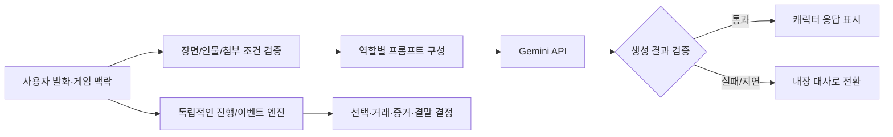

# Case Study 01 · 사기방지위원회
### 생성형 AI를 인터랙티브 금융사기 체험 게임에 적용

**프로젝트 형태:** 2인 개발 프로젝트 · **주요 관심:** AI 서비스 통합, 대화 생성 제어, 오류 대응  
**저장소:** [hoyhoy1227/whatfraud](https://github.com/hoyhoy1227/whatfraud) · [Live Demo](https://whatfraud.hoyhoy1227.chatgpt.site/)

## Problem

정해진 대사만 반복하는 게임은 상황에 맞는 반응을 주기 어렵습니다. 반대로 LLM에 대화를 완전히 맡기면 이전 선택, 금액, 거래·증거와 충돌하거나 사건의 사실을 임의로 바꿀 수 있습니다.

**목표:** 캐릭터 답변은 생성형 AI로 유연하게 만들되, 게임의 규칙과 진행 상태를 예측 가능하게 유지하는 것.

## How It Works

- 서버의 `/api/ai-chat`에서 입력·문맥을 검증하고 외부 Gemini API를 호출합니다.
- AI는 **제한된 장면의 캐릭터 발화**를 생성합니다. 가상 송금, 사건 순서, 잔액, 결말은 별도의 결정적 이벤트 엔진이 관리합니다.
- 자유 채팅 무제한 제공이 아닙니다. 현재 공개 흐름은 사건별 2/2/1회, 한 회차 총 최대 5회로 제한됩니다.
- 지연, 호출 실패, 부적절한 생성 결과는 검사 후 준비된 메시지로 대체할 수 있어 AI 없이도 완주할 수 있습니다.

## Engineering Decisions & Debugging

| 발생한 문제 | 구조적 대응 |
| --- | --- |
| 등장인물이 미공개 사실을 알고 있는 듯 대답 | 인물의 지식 범위와 게임 상태를 구분해 프롬프트·서버 검증에 반영 |
| AI가 첨부를 다시 요구하거나 정상 답장이 검사에서 탈락 | 첨부 허용 목록을 화면/서버에서 일치시키고, 표현 품질 검사와 사실·진행 검사를 분리 |
| 늦게 도착한 비동기 응답이 다른 장면에 표시될 위험 | 응답 게이트·취소와 현 요청 확인 및 장면별 대화 메모리 분리 |
| 저장·되감기에서 거래가 중복 반영될 위험 | 의미 이벤트 재생과 거래 ID 검증, 본편/짧은 체험 저장 상태 분리 |
| API 할당량·지연·품질 실패 | 입력 크기, 호출 횟수, 예산 제한 및 제한된 수정 재생성, fallback |

자동 검사에는 콘텐츠·대사, 게임 상태 복원, 송금 중복, 응답/예산 처리 등이 포함됩니다. **자동 검사는 실사용자의 학습 효과나 모든 실기기 품질을 입증하지 않습니다.**

## What I Learned

LLM 기능을 추가하는 것보다 중요한 것은 **LLM이 바꿀 수 있는 것과 바꿀 수 없는 것을 시스템 경계로 정의하는 일**이었습니다. AI의 유연성과 게임의 일관성을 별도로 설계해야 합니다.

## Contribution & Evidence

- **개인 기여:** 2인 개발로 기획과 구현 전반에 참여했습니다. 기능별 상세 역할은 개인 커밋·이슈 근거와 함께 보강할 예정입니다.
- [게임 소개 및 개발 시행착오](https://github.com/hoyhoy1227/whatfraud/blob/main/README.md)
- [AI API 코드](https://github.com/hoyhoy1227/whatfraud/blob/main/app/api/ai-chat/route.ts)
- [프로젝트 구조](https://github.com/hoyhoy1227/whatfraud/blob/main/docs/PROJECT_STRUCTURE.md)

**다음 보강:** 실제 AI 대화 캡처 2~3개, 개선 전후 비교, 본인 커밋·이슈 근거, 대표 자동 검사 결과.
